# OZYMANDIAS — Breaking the Stereochemistry Lab

### An Interactive Laboratory for Understanding Molecular Shape, Chirality, and Three-Dimensional Chemical Structure

[]()
[]()
[]()
[]()

> **OZYMANDIAS — Breaking the Stereochemistry Lab** is an educational project focused on making three-dimensional molecular structure understandable through visual exploration, stereochemical reasoning, interactive challenges, and computational representations.

The central idea is simple:

**A molecule is not just a formula or a flat drawing. Its three-dimensional arrangement matters.**

Two molecules can have the same molecular formula and the same connectivity while differing in the spatial arrangement of their atoms. These differences can produce distinct stereoisomers and are central to organic chemistry, molecular recognition, structural biology, and chemical education.

This README is designed to document the scientific foundations, learning objectives, visual models, technical concepts, and potential architecture of the project.

---

# Table of Contents

1. Project Overview
2. Why Stereochemistry Matters
3. Learning Objectives
4. Molecular Structure: From 2D to 3D
5. Chirality and Stereogenic Centres
6. Enantiomers and Diastereomers
7. Cahn–Ingold–Prelog Priority Rules
8. Assigning R and S Configuration
9. Wedge-and-Dash Notation
10. E/Z Double-Bond Stereochemistry
11. Meso Compounds and Molecular Symmetry
12. Conformational Stereochemistry
13. Three-Dimensional Molecular Visualization
14. Computational Stereochemistry
15. Interactive Laboratory Design
16. Educational Challenges and Assessment
17. Technical Diagrams
18. Testing and Scientific Validation
19. Accessibility and Performance
20. Further Reading and Scientific References

---

# 1. Project Overview

## 1.1 What is OZYMANDIAS?

OZYMANDIAS is a stereochemistry-focused educational laboratory intended to help learners understand how molecular geometry determines stereochemical identity.

Traditional chemistry diagrams are often presented as two-dimensional structures. While these drawings are useful, they can conceal the spatial relationships that define stereochemistry.

OZYMANDIAS aims to bridge that gap through:

- Three-dimensional molecular representations.
- Interactive rotation and inspection.
- Visual explanations of stereogenic centres.
- CIP priority exercises.
- R/S configuration challenges.
- E/Z double-bond activities.
- Molecular symmetry exploration.
- Enantiomer and diastereomer comparisons.
- Step-by-step educational feedback.

## 1.2 Core educational philosophy

The laboratory should encourage learners to move through four levels of understanding.

| Level | Learner activity | Desired understanding |
|---|---|---|
| 1. Recognize | Identify molecular features | Understand atoms, bonds, and geometry |
| 2. Interpret | Examine spatial arrangements | Recognize stereogenic elements |
| 3. Calculate | Apply stereochemical rules | Assign configurations correctly |
| 4. Explain | Justify the result | Communicate stereochemical reasoning |

The goal is not merely to memorize that clockwise means R or counterclockwise means S.

The goal is to understand why the assignment is correct.

## 1.3 Design principles

1. Scientific accuracy takes priority over visual effects.
2. Every stereochemical label must be supported by a valid molecular structure.
3. Three-dimensional rotation must not silently change a molecule's configuration.
4. Educational explanations should reveal the reasoning process.
5. A flat drawing must not be treated as sufficient evidence of a configuration when its stereochemical information is missing or ambiguous.

---

# 2. Why Stereochemistry Matters

Stereochemistry is the study of the spatial arrangement of atoms in molecules and how those arrangements relate to molecular properties.

A molecular structure contains more information than its molecular formula.

For example, two molecules can share:

- The same molecular formula.
- The same atoms.
- The same atom-to-atom connectivity.
- Different three-dimensional arrangements.

Such molecules may be stereoisomers.

## 2.1 The importance of molecular shape

Molecular shape affects how molecules interact with their surroundings.

Stereochemistry is relevant to:

- Molecular recognition.
- Enzyme-substrate interactions.
- Receptor binding.
- Structural biology.
- Materials science.
- Polymer chemistry.
- Pharmaceutical research.
- Chemical reaction mechanisms.

A useful conceptual model is:

```text
Molecular formula
       |
       v
Atom connectivity
       |
       v
Molecular geometry
       |
       v
Stereochemical arrangement
       |
       v
Molecular interactions
```

This is a simplified educational model. Actual molecular behaviour also depends on electronic structure, solvent, temperature, dynamics, and other environmental factors.

## 2.2 Constitutional isomers versus stereoisomers

**Constitutional isomers** differ in how their atoms are connected.

**Stereoisomers** have the same connectivity but differ in spatial arrangement.

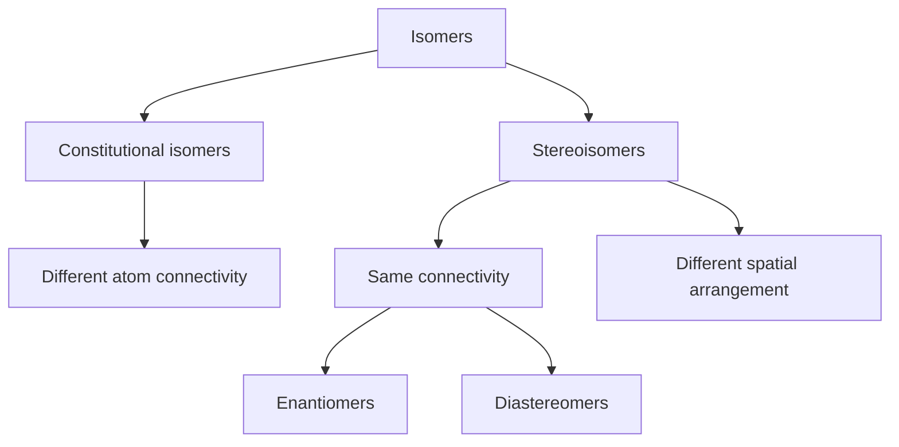

The distinction is foundational. A stereochemistry learning system should first establish connectivity before asking a learner to compare configurations.

---

# 3. Learning Objectives

After completing the laboratory, learners should be able to:

## 3.1 Molecular geometry

- Explain why many carbon atoms form approximately tetrahedral arrangements.
- Interpret three-dimensional molecular models.
- Distinguish molecular connectivity from spatial arrangement.
- Identify when a 2D structure contains sufficient stereochemical information.

## 3.2 Chirality

- Define chirality.
- Recognize common tetrahedral stereogenic centres.
- Explain why four different substituents are important for a tetrahedral carbon stereocentre.
- Compare a structure with its mirror image.
- Determine whether two structures are superimposable.

## 3.3 Stereoisomer relationships

- Define enantiomers.
- Define diastereomers.
- Distinguish stereoisomers from constitutional isomers.
- Recognize meso compounds.
- Understand the role of molecular symmetry.

## 3.4 Configuration

- Apply CIP priority rules.
- Assign R or S to a properly specified tetrahedral stereocentre.
- Identify E or Z geometry around an appropriate double bond.
- Explain why rotating a molecule is not the same as inverting a stereocentre.

## 3.5 Scientific communication

- Show stereochemical reasoning step by step.
- Explain which structural information supports an assignment.
- Identify ambiguous or incomplete stereochemical drawings.
- Report uncertainty rather than inventing a configuration.

---

# 4. Molecular Structure: From 2D to 3D

## 4.1 The limitations of flat molecular drawings

A conventional structural formula uses lines and symbols to communicate connectivity.

For example:

```text
      H
      |
CH3 — C — OH
      |
    CH2CH3
```

This representation shows the attached groups but does not, by itself, specify the complete three-dimensional arrangement around the central carbon.

A tetrahedral centre requires spatial information.

## 4.2 Tetrahedral geometry

A tetrahedral carbon has four bonding directions arranged approximately toward the corners of a tetrahedron.

The ideal tetrahedral bond angle is approximately:

\[
\theta = 109.5^\circ
\]

Conceptual diagram:

```text
                  A
                  |
                  |
                  C
               /  |  \
              B   D   E
```

This is only a schematic projection. A proper 3D model should communicate which bonds point toward and away from the viewer.

## 4.3 Three-dimensional representations

The laboratory should support several representations.

| Representation | Purpose |
|---|---|
| Ball-and-stick | Show atoms and bonds |
| Space-filling | Show approximate molecular volume |
| Wireframe | Emphasize connectivity |
| Wedge-and-dash | Communicate stereochemical orientation |
| 2D skeletal formula | Communicate molecular connectivity |
| 3D coordinate model | Support spatial inspection |

## 4.4 Rotation versus inversion

A crucial educational distinction:

**Rotating a molecule changes the viewing orientation, not its stereochemical identity.**

An inversion changes the spatial arrangement at a stereogenic centre.

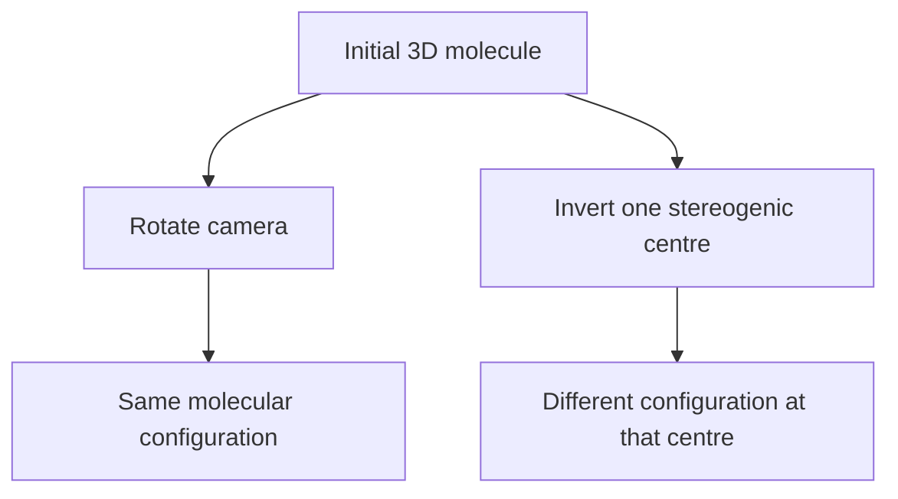

The application should demonstrate this distinction interactively.

A learner should be able to rotate a molecule through multiple viewpoints while its R/S labels remain unchanged.

---

# 5. Chirality and Stereogenic Centres

## 5.1 Definition of chirality

An object is chiral when it cannot be superimposed on its mirror image.

A familiar analogy is a pair of hands.

The left and right hands are mirror images, but they cannot be made identical through ordinary rotation.

Molecules can display the same type of relationship.

## 5.2 Tetrahedral stereogenic centres

A common stereogenic centre in introductory organic chemistry is a tetrahedral carbon attached to four distinguishable substituent groups.

For example:

```text
             A
             |
        B — C* — D
             |
             E
```

The star identifies the centre being examined.

This is a connectivity illustration, not a complete stereochemical drawing.

The four substituents must be evaluated as complete groups, not merely by looking at the first atom.

## 5.3 Important qualification

A tetrahedral atom with four different substituents is a common case of a stereogenic centre, but stereochemistry is broader than this one pattern.

Other stereogenic elements can include:

- Stereogenic double bonds.
- Axial chirality.
- Planar chirality.
- Helical chirality.
- Certain pyramidal or coordination-centre configurations.
- Non-tetrahedral stereogenic centres.

The initial educational scope may focus on tetrahedral carbon and E/Z double bonds, with advanced topics introduced separately.

## 5.4 Chirality recognition workflow

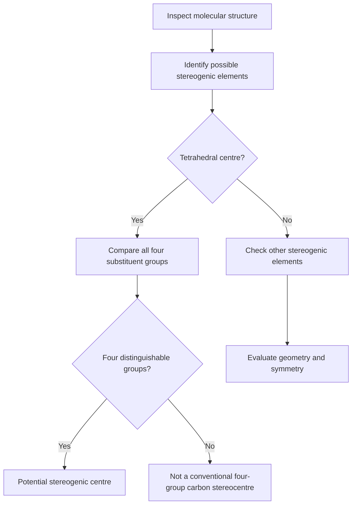

The word *potential* is important. Molecular symmetry and the full structure must still be considered before concluding that the molecule is chiral.

---

# 6. Enantiomers and Diastereomers

## 6.1 Enantiomers

Enantiomers are stereoisomers that are non-superimposable mirror images.

For a simple molecule with one tetrahedral stereogenic centre, the two configurations are often designated R and S.

```text
        Structure A          Structure B

          A                      A
          |                      |
      B — C* — D            D — C* — B
          |                      |
          E                      E

       Schematic only: the 3D wedge/dash
       arrangement must define the actual pair.
```

The diagram above illustrates the idea of exchanging groups, not a universal R/S assignment.

## 6.2 Diastereomers

Diastereomers are stereoisomers that are not mirror images of one another.

They commonly occur in molecules with multiple stereogenic elements.

For a molecule with two independent tetrahedral stereocentres, possible configurations may include:

```text
(R,R)    (R,S)    (S,R)    (S,S)
```

Whether all four structures are distinct depends on the molecular symmetry.

## 6.3 Comparison table

| Property | Enantiomers | Diastereomers |
|---|---|---|
| Mirror-image relationship | Yes | No |
| Superimposable | No | No |
| Same connectivity | Yes | Yes |
| Different stereochemical arrangement | Yes | Yes |
| Physical properties in achiral environments | Generally identical, apart from optical rotation and interactions with chiral environments | Often different |

The phrase “generally identical” is preferable to an oversimplified statement that all measured properties are identical in every possible environment.

## 6.4 Stereoisomer comparison engine

A comparison activity should:

1. Confirm identical molecular connectivity.
2. Identify all stereogenic elements.
3. Compare corresponding configurations.
4. Determine whether the structures are mirror images.
5. Account for molecular symmetry.
6. Classify the relationship.

The application should explain the classification rather than simply display a green checkmark.

---

# 7. Cahn–Ingold–Prelog Priority Rules

The Cahn–Ingold–Prelog system, usually abbreviated CIP, provides a standardized method for ranking substituents attached to stereogenic elements.

The rules are used in assigning R/S and E/Z descriptors.

## 7.1 First point of comparison

Compare the atomic numbers of the atoms directly attached to the stereogenic centre.

Higher atomic number receives higher priority.

For example:

```text
I > Br > Cl > S > O > N > C > H
```

This is a partial ordering, not a complete periodic-table sequence.

For common organic substituents:

```text
O > N > C > H
```

because oxygen has a higher atomic number than nitrogen, carbon, and hydrogen.

## 7.2 Isotopes

When directly attached atoms are isotopes of the same element, the isotope with the greater mass number receives higher priority.

For example:

```text
³H > ²H > ¹H
```

## 7.3 Comparing tied atoms

If two directly attached atoms have the same atomic number, compare the next attached atoms.

Sort each comparison set by decreasing atomic number and compare the lists in order.

Example:

```text
Group X: [O, C, H]
Group Y: [N, N, H]

First comparison:
O versus N

Since O has a higher atomic number:

Group X has higher priority.
```

The comparison stops at the first point of difference.

## 7.4 Multiple bonds

CIP treatment of multiple bonds uses duplicate-atom conventions.

A carbonyl carbon, for example, is treated for priority comparison as if it were connected to duplicate oxygen representations.

Conceptually:

```text
       O
       ||
       C

CIP comparison representation:

       O
      /
     C
      \
       O*
```

The duplicate atom is a bookkeeping device for ranking; it is not an additional physical atom.

## 7.5 A priority-assignment algorithm

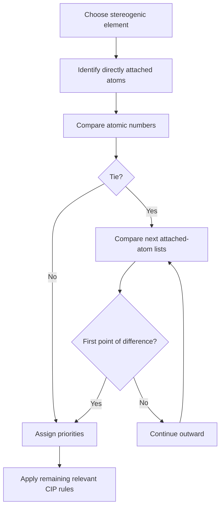

## 7.6 Recommended software behaviour

The priority-ranking interface should show:

- The atom being compared.
- Its atomic number.
- Its isotope, where relevant.
- The next comparison layer.
- The first point of difference.
- The resulting priority rank.

Avoid displaying only “Priority 1” or “Priority 2.” Learners should be able to inspect the reason.

---

# 8. Assigning R and S Configuration

## 8.1 Overview

R/S descriptors specify the absolute configuration of a stereogenic element under the applicable nomenclature rules.

For a conventional tetrahedral centre:

1. Identify the stereogenic centre.
2. Assign priorities 1 through 4.
3. Orient the lowest-priority substituent away from the viewer.
4. Trace the sequence 1 → 2 → 3.
5. Determine whether the sequence is clockwise or counterclockwise.

Under this standard viewing condition:

- Clockwise corresponds to R.
- Counterclockwise corresponds to S.

If priority 4 points toward the viewer, the apparent result must be reversed.

## 8.2 Conceptual orientation diagram

```text
          Priority 1
              |
              |
      Priority 2 — C* — Priority 3
              |
              |
          Priority 4

```

This is a simplified orientation sketch. It is not sufficient to assign a configuration without clear three-dimensional bond directions.

## 8.3 Correct reasoning sequence

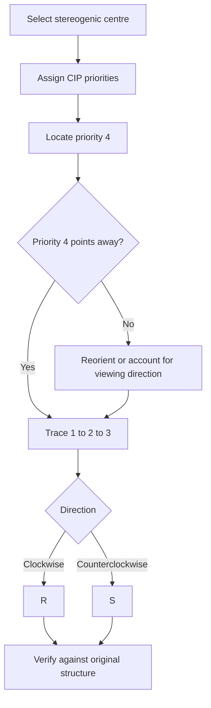

## 8.4 Common learner mistakes

| Mistake | Correction |
|---|---|
| Assigning priority based only on atom size | Use atomic number and full CIP rules |
| Assuming carbon groups are always equal | Compare their attached atoms outward |
| Forgetting the lowest-priority group | Establish its viewing direction first |
| Reading a drawing without wedge/dash information | Confirm that the 3D arrangement is specified |
| Reversing the result incorrectly | Track whether priority 4 points toward or away |
| Confusing rotation with inversion | Rotation changes viewpoint, not configuration |

## 8.5 Educational interaction

The R/S challenge should allow learners to:

- Select a stereogenic centre.
- Rank the substituents.
- Rotate the molecular model.
- Toggle a priority overlay.
- Identify the lowest-priority group.
- Select R or S.
- Request a step-by-step explanation.

The feedback should explain the exact reasoning step where an incorrect answer occurred.

---

# 9. Wedge-and-Dash Notation

Wedge-and-dash notation communicates three-dimensional bond direction in a two-dimensional drawing.

## 9.1 Three common bond styles

| Bond style | Meaning |
|---|---|
| Ordinary line | Bond lies approximately in the plane of the page |
| Solid wedge | Bond projects toward the viewer |
| Hashed wedge | Bond projects away from the viewer |

Conceptual illustration:

```text
                  A
                  |
                  C*
                /   \
             B       D
```

A proper drawing should explicitly distinguish the wedge and hashed bonds. The simple lines above are not a complete stereochemical specification.

## 9.2 Visual legend

```text
Ordinary line:       ─────

Solid wedge:         ◀────

Hashed wedge:        - - - -
```

The symbols above are explanatory approximations. In the rendered application, use actual wedge and hashed-wedge geometry rather than relying on text characters.

## 9.3 Interactive wedge editor

Recommended controls:

- Select a bond.
- Set bond as in-plane.
- Set bond as solid wedge.
- Set bond as hashed wedge.
- Rotate the molecule.
- Reset the view.
- Display the assigned configuration.
- Display a warning if the drawing is ambiguous.

The editor should preserve the molecule's intended stereochemical information when the user changes the camera angle.

---

# 10. E/Z Double-Bond Stereochemistry

## 10.1 Why E/Z exists

Rotation around a carbon-carbon double bond is restricted compared with rotation around a single bond.

When each alkene carbon has two different substituents, the relative arrangement can be stereogenic.

## 10.2 CIP priority on each alkene carbon

Assign priority independently on each carbon of the double bond.

Then compare the positions of the higher-priority substituents.

- Z: higher-priority groups are on the same side.
- E: higher-priority groups are on opposite sides.

## 10.3 Conceptual diagram

```text
Z arrangement:

   High priority     High priority
         \             /
          C  =======  C
         /             \
        X               Y


E arrangement:

   High priority
         \
          C  =======  C
                       \
                        High priority
```

The labels “high priority” refer to the substituent ranked first by the applicable CIP rules on each alkene carbon.

## 10.4 E/Z workflow

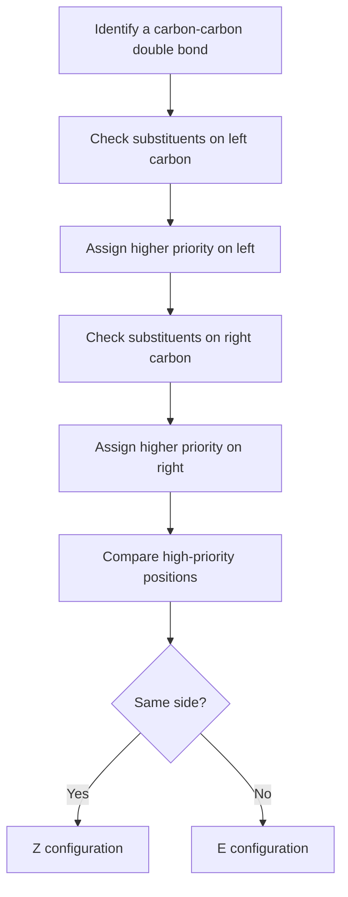

## 10.5 Learning activity

Present a double-bond structure with four substituents.

Ask the learner to:

1. Identify the two alkene carbons.
2. Rank the two groups on the first carbon.
3. Rank the two groups on the second carbon.
4. Highlight the higher-priority group on each side.
5. Select E or Z.
6. Explain the result.

Do not assign E/Z when one alkene carbon has two identical substituents or when the structure does not provide enough information.

---

# 11. Meso Compounds and Molecular Symmetry

## 11.1 What is a meso compound?

A meso compound contains stereogenic elements but is achiral because the complete molecular structure has an internal symmetry relationship that makes it superimposable on its mirror image.

This is an important exception to the simplistic assumption that a molecule with stereogenic centres must always be chiral.

## 11.2 Symmetry analysis

A symmetry-aware learning activity should encourage learners to:

- Identify all stereogenic centres.
- Inspect the entire molecular structure.
- Compare equivalent substituents.
- Search for an internal symmetry operation.
- Compare the molecule with its mirror image.
- Determine whether the structures are superimposable.

## 11.3 Schematic symmetry diagram

```text
          Left side       Right side
              \             /
               C* ------- C*
              /             \
         Matching groups  Matching groups

       A possible symmetry relationship
       depends on the complete 3D structure.
```

This diagram is conceptual, not a sufficient structural proof of meso character.

## 11.4 Important distinction

A molecule with two stereogenic centres is not automatically meso.

Likewise, the presence of a visually symmetric-looking 2D drawing is not proof of molecular achirality.

The complete structure and its stereochemical arrangement must be evaluated.

---

# 12. Conformational Stereochemistry

## 12.1 Configuration versus conformation

These terms describe different concepts.

**Configuration** concerns the defined stereochemical arrangement that cannot be changed through ordinary rotation around single bonds.

**Conformation** describes different spatial arrangements that can be reached through rotations around suitable single bonds, without breaking bonds.

## 12.2 Single-bond rotation

A molecule can adopt multiple conformations.

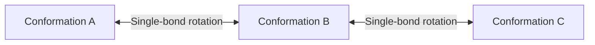

## 12.3 Educational requirements

The visualization system should:

- Allow rotation around selected single bonds.
- Show changing torsion angles.
- Display the selected bond axis.
- Compare conformational states.
- Explain that ordinary conformational rotation does not automatically invert a tetrahedral stereocentre.

## 12.4 Advanced extension

More advanced lessons may introduce:

- Newman projections.
- Sawhorse projections.
- Cyclohexane chair conformations.
- Axial and equatorial positions.
- Conformational energy diagrams.
- Atropisomerism.

These topics should be introduced after the learner understands basic configuration.

---

# 13. Three-Dimensional Molecular Visualization

## 13.1 Purpose

A 3D viewer should make molecular structure easier to inspect, not simply make the interface look impressive.

The model should help learners answer questions such as:

- Which atoms are connected?
- Which bonds point toward the viewer?
- Which bonds point away?
- Where are the stereogenic centres?
- How does the molecule appear after rotation?
- Does the configuration remain the same?

## 13.2 Suggested viewing modes

| Mode | Learning purpose |
|---|---|
| Ball-and-stick | Understand connectivity |
| Stick | Inspect bond arrangement |
| Space-filling | Understand molecular volume |
| Stereo overlay | Inspect stereochemical labels |
| CIP overlay | Understand substituent ranking |
| Comparison mode | Compare stereoisomers |

## 13.3 Interaction requirements

A useful molecular viewer should support:

- Orbit rotation.
- Zoom.
- Pan.
- Reset camera.
- Atom selection.
- Bond selection.
- Stereocentre highlighting.
- Priority numbering.
- Configuration labels.
- Optional hydrogen visibility.

## 13.4 Visual clarity

Use separate visual channels for:

- Element identity.
- Bond direction.
- CIP priority.
- Stereochemical configuration.
- Selected atoms.
- Warnings and errors.

Do not depend on colour alone. Pair colour with labels, patterns, outlines, or icons.

## 13.5 Camera and stereochemistry

A key correctness test:

> Rotating the camera around a fixed molecular structure must not change its assigned stereochemical configuration.

The 3D viewer should separate camera transformations from molecular coordinate transformations.

---

# 14. Computational Stereochemistry

## 14.1 Why computational validation matters

A visual model and a stereochemical label must agree.

A molecular structure may contain:

- Connectivity information.
- Bond order.
- Atomic identity.
- Isotope information.
- Formal charge.
- 2D coordinates.
- 3D coordinates.
- Explicit stereochemical annotations.

Not every file format preserves all these features equally well.

## 14.2 Molecular representation

A conceptual molecule data model may look like this:

```text
Molecule
 ├── Atoms
 │    ├── Element
 │    ├── Isotope
 │    ├── Charge
 │    └── Coordinates
 │
 ├── Bonds
 │    ├── Atom A
 │    ├── Atom B
 │    ├── Bond order
 │    └── Stereo information
 │
 └── Stereochemistry
      ├── Tetrahedral centres
      ├── Double-bond geometry
      ├── Relative stereo groups
      └── Configuration metadata
```

This is a conceptual schema, not a claim about the repository's current data model.

## 14.3 Suggested computational workflow

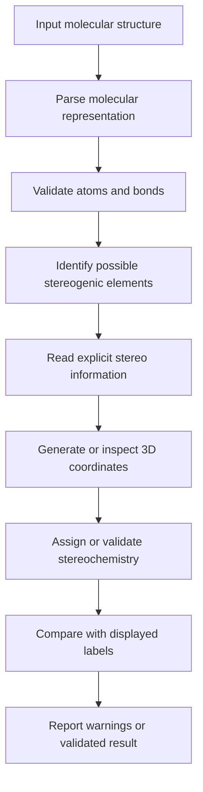

## 14.4 RDKit as a possible chemistry toolkit

[RDKit](https://www.rdkit.org/) is a widely used open-source cheminformatics toolkit.

It provides functionality for molecular representations, stereochemistry assignment, molecular descriptors, and structure handling.

Potential uses include:

- Parsing SMILES.
- Identifying possible stereogenic centres.
- Assigning stereochemical labels.
- Inspecting double-bond stereochemistry.
- Generating molecular depictions.
- Validating stereochemical representations.

The exact integration should be selected according to the project's language, architecture, and deployment requirements.

## 14.5 SMILES stereochemical notation

SMILES can encode stereochemical information.

For example, `@` and `@@` are local stereochemical notation markers in SMILES.

**Important:** `@` does not universally mean R, and `@@` does not universally mean S.

Their interpretation depends on the order in which neighbouring atoms are represented in the SMILES string.

A robust application should use a stereochemistry-aware parser rather than attempting to translate these symbols directly into R/S labels.

## 14.6 Validation principle

Never assume that a visually plausible 3D model proves that the encoded stereochemistry is correct.

The application should compare:

1. Input stereochemical annotations.
2. Parsed molecular structure.
3. Generated or imported 3D coordinates.
4. Independently assigned stereochemical labels.
5. Rendered labels and bond directions.

Any disagreement should produce a visible warning.

---

# 15. Interactive Laboratory Design

## 15.1 Proposed laboratory modules

The following modules provide a structured learning path.

| Module | Activity | Core concept |
|---|---|---|
| 01 | Molecular orientation | 3D geometry |
| 02 | Find the centre | Stereogenic centres |
| 03 | Mirror challenge | Chirality |
| 04 | Priority laboratory | CIP rules |
| 05 | R/S challenge | Absolute configuration |
| 06 | Wedge editor | 2D-to-3D interpretation |
| 07 | Double-bond challenge | E/Z |
| 08 | Isomer comparison | Enantiomers and diastereomers |
| 09 | Symmetry laboratory | Meso compounds |
| 10 | Conformation laboratory | Molecular rotation |

## 15.2 Learning loop

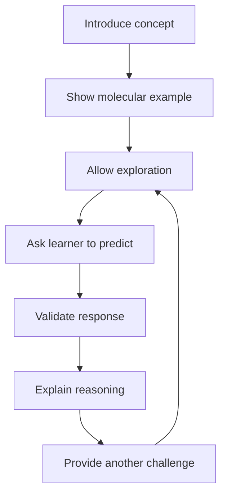

## 15.3 Progressive difficulty

### Beginner

- Identify atoms and bonds.
- Recognize tetrahedral geometry.
- Understand wedge-and-dash notation.
- Identify possible stereogenic centres.

### Intermediate

- Apply CIP priorities.
- Assign R/S.
- Distinguish enantiomers and diastereomers.
- Assign E/Z.

### Advanced

- Analyze multiple stereogenic centres.
- Identify meso structures.
- Explore stereochemical ambiguity.
- Examine conformational effects.
- Investigate more advanced stereogenic elements.

## 15.4 Feedback system

Feedback should identify the learner's reasoning error.

Example:

**Learner response:** Incorrect priority order.

**Feedback:** "You selected the carbon substituent above the oxygen substituent. The directly attached atoms are compared first. Oxygen has a higher atomic number than carbon, so the oxygen-containing substituent wins at this comparison stage."

This is more useful than simply displaying "Incorrect."

---

# 16. Educational Challenges and Assessment

## 16.1 Challenge categories

### Challenge A — Identify the stereogenic centre

Display a molecule and ask the learner to select a potential tetrahedral stereogenic centre.

### Challenge B — Rank the substituents

Display four substituents and ask the learner to order them according to CIP rules.

### Challenge C — Assign R/S

Allow the learner to rotate the molecule, inspect priority labels, and assign the configuration.

### Challenge D — Compare mirror images

Show a molecule and its mirror image. Ask whether they are superimposable.

### Challenge E — Identify E/Z

Display a stereogenic double bond and ask the learner to compare higher-priority groups.

### Challenge F — Find the meso structure

Present several structures and ask the learner to identify whether a complete molecular symmetry relationship makes one achiral.

## 16.2 Assessment principles

Assessment should measure:

- Correct identification.
- Correct priority ranking.
- Correct stereochemical assignment.
- Understanding of molecular orientation.
- Ability to explain the reasoning.
- Recognition of insufficient information.

## 16.3 Example scoring model

| Performance | Suggested feedback |
|---|---|
| Correct answer and explanation | Strong understanding |
| Correct answer, incomplete explanation | Review reasoning |
| Incorrect priority order | Revisit CIP comparisons |
| Incorrect orientation | Revisit wedge-and-dash notation |
| Correct method, arithmetic or selection error | Retry with a focused hint |
| Insufficient structural information | Explain why no unique assignment is possible |

A learner should not lose credit for correctly identifying that a problem is under-specified.

---

# 17. Technical Diagrams

This section collects diagrams that can be reused in educational documentation and interface planning.

## 17.1 Overall stereochemistry classification

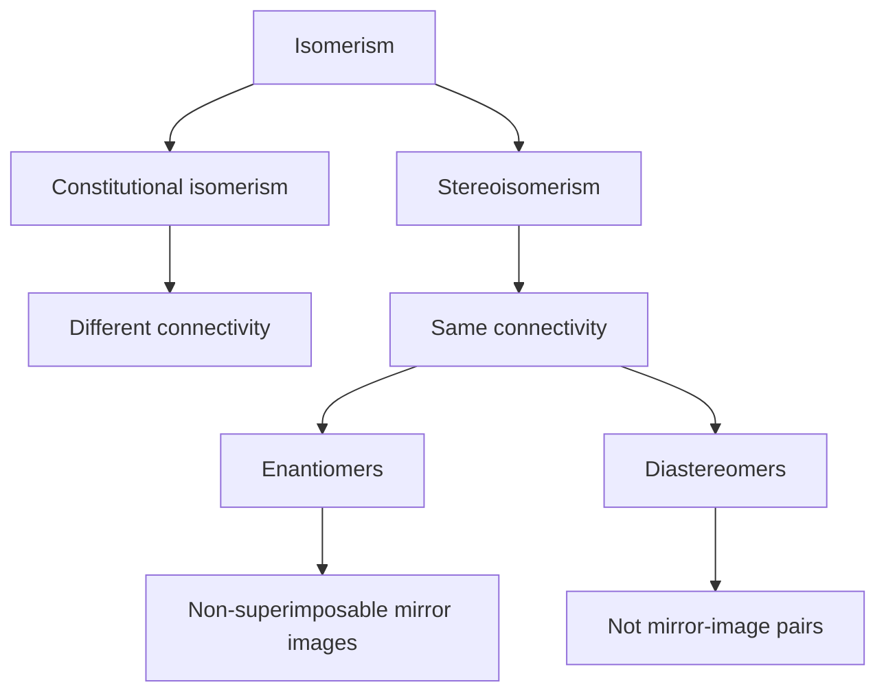

## 17.2 CIP decision process

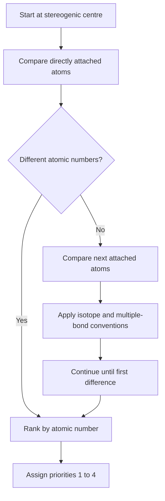

## 17.3 R/S assignment process

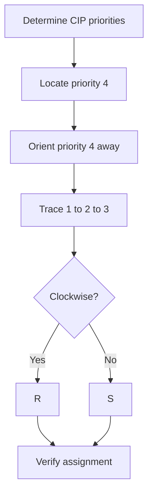

## 17.4 Molecular viewer architecture

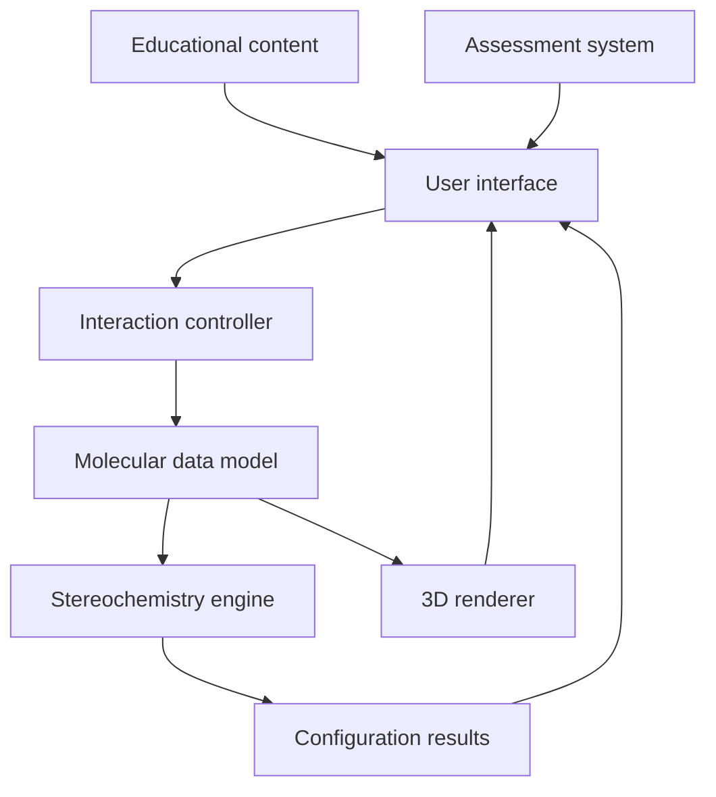

## 17.5 Data validation flow

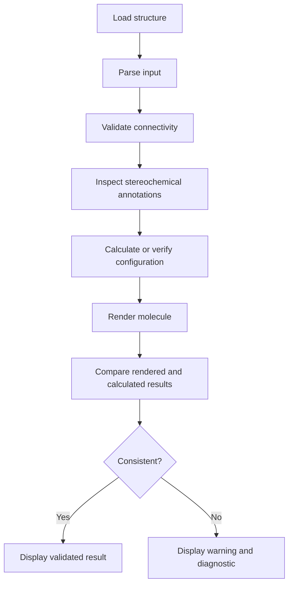

## 17.6 Suggested screen layout

```text
+----------------------------------------------------------+
| OZYMANDIAS — STEREOCHEMISTRY LAB                         |
+----------------------+-----------------------------------+
|                      |                                   |
|  LEARNING OBJECTIVE  |       3D MOLECULAR VIEWER         |
|                      |                                   |
|  Identify centre     |          [Molecule]               |
|  Rank substituents   |                                   |
|  Assign R/S          |      Rotate / Zoom / Reset        |
|                      |                                   |
+----------------------+-----------------------------------+
| CIP PRIORITY PANEL                                       |
|                                                          |
| Priority 1: [Group]    Priority 2: [Group]                |
| Priority 3: [Group]    Priority 4: [Group]                |
+----------------------------------------------------------+
| EXPLANATION / HINT / VALIDATION                           |
+----------------------------------------------------------+
| [Check answer]   [Hint]   [Reset]   [Next challenge]     |
+----------------------------------------------------------+
```

---

# 18. Testing and Scientific Validation

Scientific correctness must be tested independently of visual appearance.

## 18.1 Molecular structure tests

Test that:

- Atoms are represented correctly.
- Bond connectivity is preserved.
- Bond order is preserved.
- Isotope information is retained where supported.
- Explicit stereochemical annotations are not silently discarded.
- Missing stereochemical information is not invented.

## 18.2 R/S tests

Include test cases covering:

- Four different directly attached atoms.
- Carbon substituents that require comparison beyond the first atom.
- Isotope priority.
- Multiple-bond duplicate-atom conventions.
- A lowest-priority group pointing toward the viewer.
- A lowest-priority group pointing away.
- Molecules with more than one stereogenic centre.
- Structures with unspecified stereochemistry.

## 18.3 E/Z tests

Include:

- A valid E structure.
- A valid Z structure.
- A double bond with identical substituents on one carbon.
- Structures with different priority groups.
- Structures with missing or ambiguous stereochemical information.

## 18.4 Rotation tests

The following should remain true:

- Camera rotation does not change configuration.
- Zoom does not change configuration.
- Pan does not change configuration.
- Re-rendering does not change configuration.
- A deliberate stereochemical inversion is detected.
- Export and import preserve supported stereo information.

## 18.5 Example test matrix

| Test | Expected behaviour |
|---|---|
| Rotate camera | Configuration unchanged |
| Change zoom | Configuration unchanged |
| Select stereocentre | Correct centre highlighted |
| Change wedge to dash | Stereo state updated or validated |
| Remove stereo annotation | Configuration reported as unspecified where appropriate |
| Compare mirror image | Relationship evaluated using full structure |
| Parse E/Z structure | Geometry retained |
| Import ambiguous structure | Warning shown |

## 18.6 Scientific validation checklist

- [ ] CIP priorities follow applicable rules.
- [ ] Isotope priorities are supported.
- [ ] Multiple-bond comparisons are handled correctly.
- [ ] R/S labels agree with the encoded stereochemistry.
- [ ] E/Z labels agree with the encoded geometry.
- [ ] Camera movement does not alter configuration.
- [ ] Mirror-image comparisons use the complete molecular structure.
- [ ] Meso classification accounts for molecular symmetry.
- [ ] Unspecified stereochemistry remains unspecified.
- [ ] Educational explanations match the displayed structure.

---

# 19. Accessibility and Performance

## 19.1 Accessibility

A stereochemistry application must not rely exclusively on colour.

Provide:

- Text labels for R and S.
- Text labels for E and Z.
- Distinct line patterns for bond directions.
- Keyboard-accessible controls.
- Clear focus indicators.
- Screen-reader descriptions of selected atoms and bonds.
- A non-3D explanation of every required interaction.

## 19.2 Performance

Molecular visualization should remain responsive when the learner rotates, zooms, or changes display modes.

Potential performance strategies:

- Reuse molecular geometry when possible.
- Avoid unnecessary recalculation during camera movement.
- Separate camera state from molecular stereochemical state.
- Use efficient rendering updates.
- Load advanced visual features only when needed.
- Keep educational explanations available even if 3D rendering is unavailable.

## 19.3 Graceful fallback

If a 3D model cannot be rendered, the application should still provide:

- A 2D structural drawing.
- A stereochemical text description.
- The molecular connectivity.
- A warning about unavailable 3D inspection.
- A way to continue with non-3D educational activities.

---

# 20. Further Reading and Scientific References

The following resources are useful for developing and validating a stereochemistry education project.

## 20.1 Stereochemistry and teaching

1. **Cambridge Crystallographic Data Centre — Stereochemistry Teaching Module**

   Introduces chirality, stereogenic centres, R/S assignments, enantiomers, diastereomers, and meso compounds.

   https://www.ccdc.cam.ac.uk/media/stereochemistry_point_chirality_teaching_subset.pdf

2. **OpenChemLib / OCL Stereochemistry Documentation**

   Discusses stereochemistry representation, relative configurations, and enhanced stereochemical recognition.

   https://docs.nmrium.org/ocl/stereochemistry

## 20.2 Computational chemistry

3. **RDKit Documentation**

   Molecular representations, stereochemistry assignment, and cheminformatics functionality.

   https://www.rdkit.org/docs/

4. **RDKit Cookbook — Stereochemistry**

   Examples for identifying stereochemical information in molecular structures.

   https://rdkit.org/docs/Cookbook.html

5. **StereoMolGraph**

   A research-oriented project exploring stereochemistry-aware molecular and reaction graph representations.

   https://github.com/maxim-papusha/StereoMolGraph

## 20.3 Molecular visualization

6. **Three.js Documentation**

   A JavaScript 3D graphics library that may be useful for building a custom molecular visualization interface.

   https://threejs.org/docs/

7. **React Three Fiber Documentation**

   React renderer for Three.js, potentially useful if the application uses React.

   https://r3f.docs.pmnd.rs/

---

# 21. Suggested Future Development

The following enhancements could extend the educational scope.

## 21.1 Advanced stereochemistry

- Axial chirality.
- Atropisomerism.
- Helical chirality.
- Planar chirality.
- Coordination stereochemistry.
- Relative stereochemistry.
- Stereochemical descriptors for more complex structures.

## 21.2 Advanced molecular visualization

- Side-by-side stereoisomer comparison.
- Synchronized camera rotation.
- Mirror-plane visualization.
- Atom-by-atom CIP comparison.
- Dynamic conformational exploration.
- Molecular symmetry inspection.

## 21.3 Expanded learning features

- Guided lessons.
- Adaptive practice.
- Explanation-first challenges.
- Learner progress tracking.
- Downloadable practice sets.
- Instructor mode.
- Scientific glossary.
- Reference structure library.

## 21.4 Research-oriented extensions

For an advanced version, possible extensions include:

- Stereochemistry-aware molecular graph representations.
- Structure comparison and isomorphism.
- 3D coordinate-based stereo inference.
- Molecular format conversion.
- Stereochemical validation reports.
- Integration with established cheminformatics libraries.

These should be treated as future development directions unless they are already implemented.

---

# 22. Contributing

Contributions should prioritize scientific correctness, clarity, and reproducibility.

Potential contribution areas include:

- Educational explanations.
- Stereochemical diagrams.
- Molecular examples.
- Test structures.
- Accessibility improvements.
- Visualization improvements.
- Documentation.
- Computational validation.

## Contribution guidelines

1. Explain the scientific purpose of a proposed change.
2. Provide a reproducible example when changing stereochemical logic.
3. Include tests for configuration-sensitive changes.
4. Do not replace scientific validation with visual inspection alone.
5. Document limitations and unsupported molecular cases.
6. Preserve unspecified stereochemistry when the input does not determine a unique configuration.

---

# 23. License

**License:** To be confirmed from the repository's existing `LICENSE` file.

Do not assume a license or reuse third-party code, molecular structures, or images without checking their respective permissions.

---

# 24. Project Summary

OZYMANDIAS — Breaking the Stereochemistry Lab is centered on one of the most important ideas in molecular chemistry:

**The arrangement of atoms in three-dimensional space is part of a molecule's identity.**

A strong stereochemistry learning environment should connect:

- Molecular connectivity.
- Three-dimensional geometry.
- Chirality.
- CIP priority rules.
- R/S configuration.
- E/Z geometry.
- Enantiomers and diastereomers.
- Molecular symmetry.
- Computational validation.
- Scientific explanation.

The most important design requirement is that every visual representation must remain chemically meaningful.

A beautiful 3D model is not enough. A correct stereochemical label is not enough. The learner should be able to understand how the molecular structure supports the label and why the result remains valid when the molecule is viewed from another direction.

**OZYMANDIAS should make stereochemistry visible, understandable, testable, and explainable.**

---

*Documentation note: This is a long-form documentation draft. Confirm the repository's actual features, dependencies, installation instructions, license, and implementation details before publishing it as a description of the current software.*
